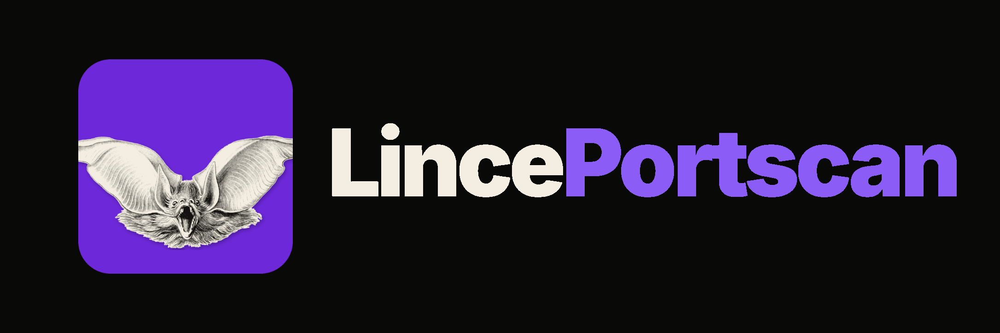
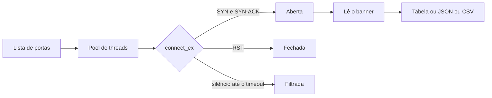

<p align="center"><sub>Lince Portscan</sub></p>

---

<p align="center">
  
</p>

<p align="center">
  Scanner de portas TCP em Python com threads, banner grabbing e saída em JSON ou CSV
</p>

<p align="center">
  
  
  <a href="https://github.com/arthurlynow098/lince-portscan/actions/workflows/testes.yml"></a>
  
</p>

## Sobre o projeto

Quando comecei a estudar segurança, o Nmap parecia mágica. Você digita um IP e ele te devolve tudo que está rodando na máquina. Eu queria entender o que acontece por baixo, então resolvi escrever o meu próprio scanner do zero, só com a biblioteca padrão do Python.

O Lince Portscan faz um **TCP connect scan**, o mesmo tipo do `nmap -sT`. Ele testa várias portas ao mesmo tempo usando threads, tenta adivinhar o serviço de cada porta e ainda lê o **banner**, aquela primeira mensagem que serviços como SSH e FTP mandam assim que você conecta. Muitas vezes o banner já entrega a versão do software, e é a partir daí que um pentester começa a procurar vulnerabilidade conhecida.

## Como funciona



## Tecnologias

<p>
  
  
  
</p>

## Executando o código

Não precisa instalar nada além do Python 3.10 ou mais novo.

```bash
git clone https://github.com/arthurlynow098/lince-portscan.git
cd lince-portscan

# portas mais comuns
python -m portscan scanme.nmap.org

# intervalo personalizado, salvando em JSON
python -m portscan 192.168.0.10 -p 1-1024,3306,8080 -o resultado.json

# mostrar também as fechadas e filtradas
python -m portscan 127.0.0.1 -p 20-25 --todas
```

| Opção | Para que serve |
|---|---|
| `-p`, `--portas` | Lista e intervalos, tipo `22,80,8000-8100` |
| `-t`, `--threads` | Quantas conexões ao mesmo tempo (padrão 200) |
| `--timeout` | Quanto tempo esperar por porta, em segundos |
| `--sem-banner` | Pula a leitura do banner e fica mais rápido |
| `-o`, `--saida` | Salva em `.json` ou `.csv` |

Rodando os testes

```bash
pip install -r requirements-dev.txt
python -m pytest -q
```

Os testes sobem um servidor falso que finge ser um SSH, então dá para validar a leitura de banner sem depender de internet.

## Exemplo

```text
  lince portscan 1.0.0
  alvo scanme.nmap.org (45.33.32.156) com 31 portas e 200 threads

  PORTA   ESTADO     SERVIÇO         BANNER
  22      aberta     ssh             SSH-2.0-OpenSSH_6.6.1p1 Ubuntu-2ubuntu2.13
  80      aberta     http            HTTP/1.1 200 OK

  2 aberta(s) em 2.0s
```

## Estudei por aqui

Segui essas aulas e materiais para entender e aplicar tudo que está aqui.

| Material | O que tirei dele |
|---|---|
| [TryHackMe, sala Nmap](https://tryhackme.com/room/furthernmap) | Tipos de scan, estados de porta e como o Nmap decide cada um |
| [TryHackMe, What is Networking?](https://tryhackme.com/room/whatisnetworking) | Base de redes, IP, portas e protocolos |
| [Documentação do módulo socket](https://docs.python.org/3/library/socket.html) | `connect_ex`, timeouts e códigos de erro |
| [MITRE ATT&CK T1046, Network Service Discovery](https://attack.mitre.org/techniques/T1046/) | Como esse tipo de varredura aparece do lado de quem defende |
| [Curso em Vídeo, Python Mundo 1](https://www.youtube.com/playlist?list=PLHz_AreHm4dlKP6QQCekuIPky1CiwmdI6) | Base de Python que usei em todos os projetos |

## Licença

Distribuído sob a licença MIT. Veja o arquivo [LICENSE](LICENSE).

<p align="center"><sub>A gravura do banner é o morcego orelhudo de Ernst Haeckel, de 1904, em domínio público no <a href="https://commons.wikimedia.org/wiki/File%3AHaeckel_Chiroptera_Plecotus_auritus_2.jpg">Wikimedia Commons</a>.</sub></p>
