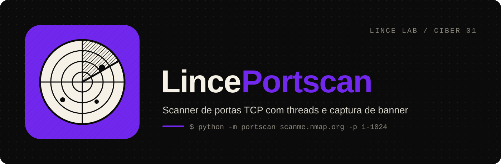
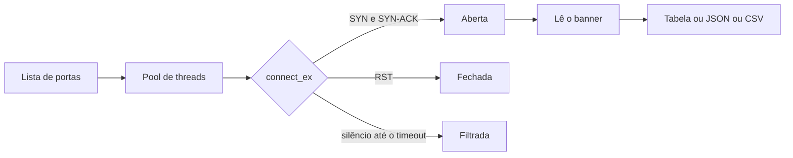

<a id="top"></a>

<p align="center"></p>

<p align="center">


<a href="https://github.com/arthurlynow098/lince-portscan/actions/workflows/testes.yml"></a>

</p>

<p align="center"><a href="#sobre">Sobre</a> &nbsp;&nbsp; <a href="#como-funciona">Como funciona</a> &nbsp;&nbsp; <a href="#rodando">Rodando</a> &nbsp;&nbsp; <a href="#aprendi">O que aprendi</a> &nbsp;&nbsp; <a href="#estudos">Estudos</a></p>

> [!WARNING]
> Só escaneie máquinas suas ou que você tem autorização por escrito para testar. Para treinar sem dor de cabeça existe o `scanme.nmap.org`, que o próprio pessoal do Nmap deixa aberto para isso.

<a id="sobre"></a>

<p></p>

Quando comecei a estudar segurança, o Nmap parecia mágica. Você digita um IP e ele te devolve tudo que está rodando na máquina. Eu queria entender o que acontece por baixo, então resolvi escrever o meu próprio scanner do zero, só com a biblioteca padrão do Python.

O Lince Portscan faz um **TCP connect scan**, o mesmo tipo do `nmap -sT`. Ele testa várias portas ao mesmo tempo usando threads, tenta adivinhar o serviço de cada porta e ainda lê o **banner**, aquela primeira mensagem que serviços como SSH e FTP mandam assim que você conecta. Muitas vezes o banner já entrega a versão do software, e é a partir daí que um pentester começa a procurar vulnerabilidade conhecida.

<a id="como-funciona"></a>

<p></p>



| Estado | O que significa na prática |
|---|---|
| **aberta** | O handshake completou, tem algum serviço escutando ali |
| **fechada** | O host respondeu com RST, ele está de pé mas nada escuta na porta |
| **filtrada** | Nada voltou, quase sempre é um firewall descartando o pacote |

Algumas decisões que tomei e por quê

- **Threads em vez de asyncio.** O trabalho é quase todo espera de rede, e enquanto a thread espera o GIL fica livre. Com 200 threads um scan das 1024 primeiras portas leva poucos segundos.
- **HEAD em portas HTTP.** Servidor web não fala nada até receber uma requisição, então nas portas tipo 80 e 8080 eu mando um `HEAD /` para conseguir o banner.
- **Código de erro do Windows.** No Windows a conexão recusada volta como `10061` e não como `ECONNREFUSED`. Descobri isso quando os testes passaram no Linux e quebraram na minha máquina.

<a id="rodando"></a>

<p></p>

Não precisa instalar nada além do Python 3.10 ou mais novo.

```bash
git clone https://github.com/arthurlynow098/lince-portscan.git
cd lince-portscan

# portas mais comuns
python -m portscan scanme.nmap.org

# intervalo personalizado, salvando em JSON
python -m portscan 192.168.0.10 -p 1-1024,3306,8080 -o resultado.json

# mostrar também as fechadas e filtradas
python -m portscan 127.0.0.1 -p 20-25 --todas
```

| Opção | Para que serve |
|---|---|
| `-p`, `--portas` | Lista e intervalos, tipo `22,80,8000-8100` |
| `-t`, `--threads` | Quantas conexões ao mesmo tempo (padrão 200) |
| `--timeout` | Quanto tempo esperar por porta, em segundos |
| `--sem-banner` | Pula a leitura do banner e fica mais rápido |
| `-o`, `--saida` | Salva em `.json` ou `.csv` |

Rodando os testes

```bash
pip install -r requirements-dev.txt
python -m pytest -q
```

Os testes sobem um servidor falso que finge ser um SSH, então dá para validar a leitura de banner sem depender de internet.

<p></p>

```text
  lince portscan 1.0.0
  alvo scanme.nmap.org (45.33.32.156) com 31 portas e 200 threads

  PORTA   ESTADO     SERVIÇO         BANNER
  22      aberta     ssh             SSH-2.0-OpenSSH_6.6.1p1 Ubuntu-2ubuntu2.13
  80      aberta     http            HTTP/1.1 200 OK

  2 aberta(s) em 2.0s
```

<a id="aprendi"></a>

<p></p>

- Como funciona o three-way handshake na prática e por que um RST é diferente de um silêncio
- A diferença entre `connect` e `connect_ex` e como tratar timeout sem travar o programa
- Usar `ThreadPoolExecutor` para trabalho de I/O e por que ele não ajuda em trabalho de CPU
- Banner grabbing como primeira etapa de enumeração em um pentest
- Escrever teste para código de rede subindo um servidor fake dentro do próprio teste

Próximos passos que quero fazer

- [ ] SYN scan com Scapy, que é mais discreto que o connect scan
- [ ] Varredura de UDP
- [ ] Ler um intervalo CIDR inteiro, tipo `192.168.0.0/24`

<a id="estudos"></a>

<p></p>

Segui essas aulas e materiais para entender e aplicar tudo que está aqui.

| Material | O que tirei dele |
|---|---|
| [TryHackMe, sala Nmap](https://tryhackme.com/room/furthernmap) | Tipos de scan, estados de porta e como o Nmap decide cada um |
| [TryHackMe, What is Networking?](https://tryhackme.com/room/whatisnetworking) | Base de redes, IP, portas e protocolos |
| [Documentação do módulo socket](https://docs.python.org/3/library/socket.html) | `connect_ex`, timeouts e códigos de erro |
| [MITRE ATT&CK T1046, Network Service Discovery](https://attack.mitre.org/techniques/T1046/) | Como esse tipo de varredura aparece do lado de quem defende |
| [Curso em Vídeo, Python Mundo 1](https://www.youtube.com/playlist?list=PLHz_AreHm4dlKP6QQCekuIPky1CiwmdI6) | Base de Python que usei em todos os projetos |

<p align="center"><sub>Parte do <a href="https://github.com/arthurlynow098">Lince Lab</a>, minha coleção de projetos de cibersegurança</sub></p>

<p align="center"><a href="#top">Voltar ao topo</a></p>
